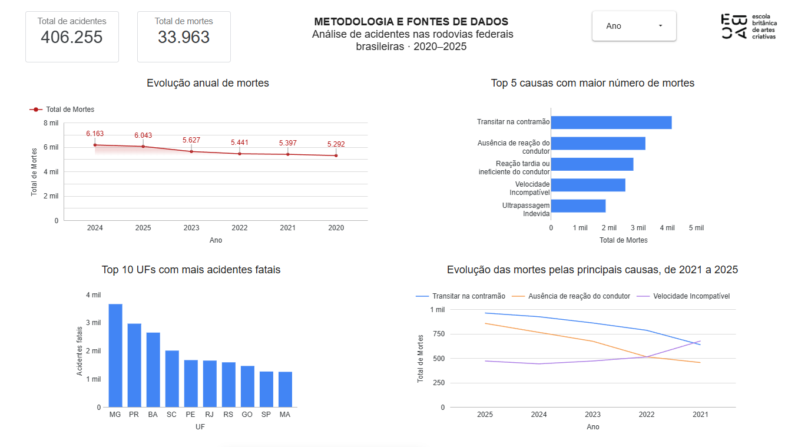

# Análise de Acidentes em Rodovias Federais Brasileiras (2020–2025)

## Sobre o projeto

Este projeto tem como objetivo analisar os registros de acidentes nas rodovias federais brasileiras entre 2020 e 2025, buscando identificar tendências ao longo dos anos, causas associadas às mortes e diferenças entre as unidades federativas.

A proposta é utilizar dados públicos para transformar registros em informações que contribuam para uma melhor compreensão do cenário da segurança viária no Brasil.

## Objetivos

- Analisar a evolução anual dos acidentes e das mortes.
- Identificar as causas de acidentes com maior número de mortes registradas.
- Comparar a quantidade de acidentes fatais entre as unidades federativas.
- Desenvolver um dashboard interativo para apresentar os resultados.

## Fonte de dados

Os dados utilizados são provenientes do conjunto de dados abertos de acidentes de trânsito da Polícia Rodoviária Federal (PRF).

Fonte oficial: https://www.gov.br/prf/pt-br/acesso-a-informacao/dados-abertos

## Ferramentas utilizadas

- **Python:** preparação e exploração dos dados.
- **Pandas:** manipulação e análise dos dados.
- **SQL:** consultas e agregações.
- **DuckDB:** execução de consultas SQL.
- **Looker Studio:** criação do dashboard interativo.
- **Google Colab:** ambiente utilizado para desenvolver a análise.

## Etapas do projeto

1. Coleta e consolidação dos arquivos anuais.
2. Tratamento e verificação da qualidade dos dados.
3. Análise exploratória utilizando Python e Pandas.
4. Consultas e agregações com SQL.
5. Construção de gráficos e indicadores no Looker Studio.
6. Interpretação dos resultados e elaboração de insights.

## Principais análises

- Evolução anual das mortes registradas.
- Principais causas associadas às mortes.
- Distribuição de acidentes classificados como fatais por unidade federativa.
- Evolução das mortes associadas às principais causas entre 2021 e 2025.

## Limitações

Os resultados refletem os registros disponíveis na base analisada. As contagens absolutas não representam, isoladamente, o risco de acidentes em cada estado nem demonstram relações de causa e efeito.

A análise comparativa das causas considera o período de 2021 a 2025, devido a diferenças na classificação das causas em 2020.

## Dashboard

O dashboard interativo desenvolvido no Looker Studio será disponibilizado aqui.

**Link:** https://datastudio.google.com/reporting/e5111522-b926-4ec2-b36f-e6717a88c2e5

## Prévia do dashboard

